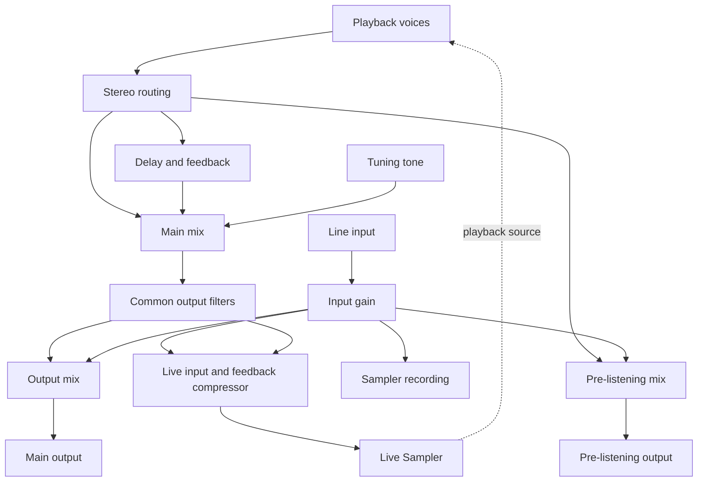
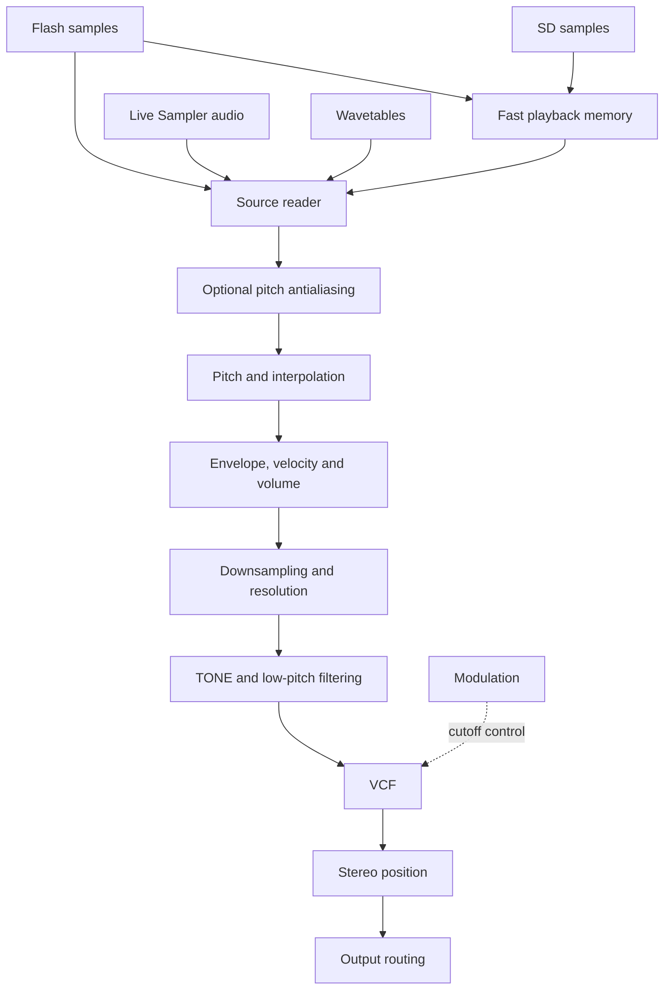
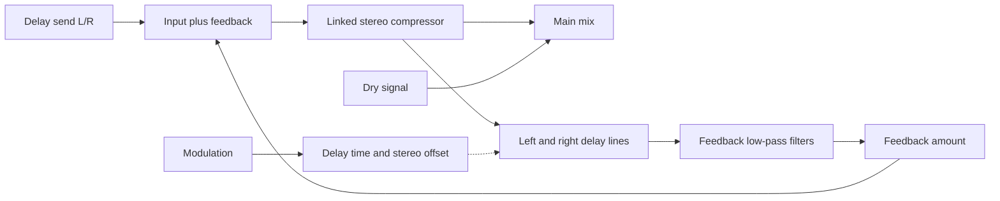
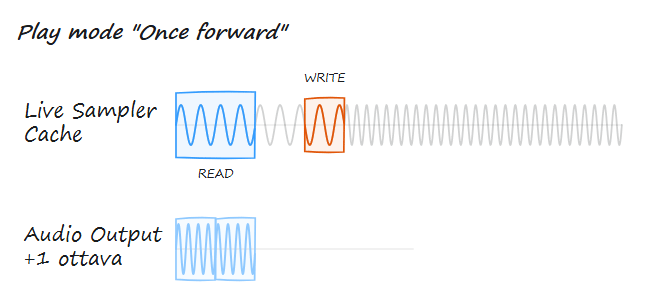
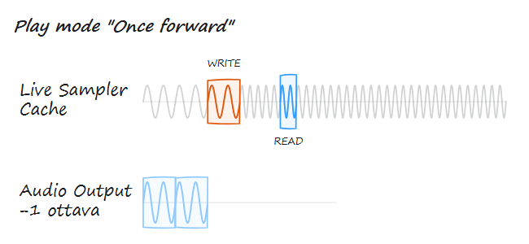

# Firmware Architecture

This document explains how LILLA's firmware brings playback, recording, effects and controls together. It describes firmware **7.2.10**, focusing on the role of each part and how the parts work together.

For operating instructions, see the [User Guide](User%20Guide.md). Developers can consult the separate [implementation notes](docs/firmware-implementation-notes.md) for source references, exact limits and storage details.

## Contents

- [1. Platform and organization](#1-platform-and-organization)
- [2. Execution model and synchronization](#2-execution-model-and-synchronization)
- [3. Audio signal flow](#3-audio-signal-flow)
- [4. AudioPlayer](#4-audioplayer)
- [5. Delay](#5-delay)
- [6. Patch, sound and voice model](#6-patch-sound-and-voice-model)
- [7. Pitch-dependent polyphony](#7-pitch-dependent-polyphony)
- [8. Memory and persistence](#8-memory-and-persistence)
- [9. Recording and capture workflows](#9-recording-and-capture-workflows)
- [10. MIDI and loop scheduling](#10-midi-and-loop-scheduling)

  

## 1. Platform and organization

> *Introduces the processing platform and the main groups of components that make up the instrument.*

LILLA runs on a Teensy 4.1, using the Arduino framework and Teensy Audio library. Its firmware connects a sound engine, recording and storage services, MIDI handling, and the physical controls and display.

The application brings these components together at startup. Each component then handles a particular responsibility, while the application coordinates operations such as changing a patch or saving a recording.

| Component group | Main responsibility |
| --- | --- |
| Sound engine | Play samples, manage voices and apply sound shaping. |
| Effects and routing | Combine signals and send them to effects, monitoring and outputs. |
| Recording and storage | Record audio, load samples and preserve saved material. |
| MIDI | Receive performance gestures and record or replay note sequences. |
| Controls and display | Interpret user actions and present the current settings. |

  

## 2. Execution model and synchronization

> *Explains how audio processing continues alongside controls, screen updates and storage operations.*

At startup, LILLA initializes the hardware and restores its saved settings before enabling audio processing. During normal use, work follows two closely coordinated paths.

The audio path runs at regular intervals, processing blocks of 128 samples: approximately 2.9 milliseconds of sound. It handles incoming MIDI, prepares the playing voices and advances the connected audio stages. Each block must be ready in time for playback to remain continuous.

Alongside this, the application scans the controls, updates the display and coordinates loading and saving. Transfers that can be spread over time are divided into smaller steps so they can coexist with audio processing.

When a control change affects several related settings, they are handed to the sound engine together. The processing order also matters, particularly for feedback and live recording: the signal-flow diagrams show connections, while scheduling determines when each component acts on them.

  

## 3. Audio signal flow

> *Follows sound from the playing voices and line input to effects, recording, monitoring and the main output.*

Each playing voice produces a stereo signal. Routing sends it to the main mix, the delay effect and the pre-listening output according to the selected settings.

Main playback passes through common output filters before being combined with input monitoring. Pre-listening has a separate mix and output, allowing material to be auditioned independently.

The input also supplies both recording modes. Live Sampler can combine that input with sound returning from the playback path; its feedback is separate from the delay's feedback.

  

## 4. AudioPlayer

> *Describes how a voice turns stored audio into a note, then shapes its volume, timbre and stereo position.*

An AudioPlayer is one playback voice. It reads the selected source, follows its playback direction and loop settings, and produces the sound of a note. Up to 16 voices share the engine.

### Reading and pitch

Samples can come from Flash, fast playback memory or the Live Sampler buffer. SD material is loaded into playback memory before notes use it. A separate wavetable path supplies prepared repeating waveforms.

Pitch determines how quickly the voice moves through the source. Higher notes read faster; lower notes read more slowly. Interpolation calculates values between stored samples, and short transitions help smooth changes at playback boundaries.

### Volume and texture

The envelope shapes the note's attack, sustain and release. Velocity and volume set its level, while pan places it in the stereo field.

Downsampling deliberately holds sample values longer, and resolution reduces their amplitude precision. Both create changes in texture without changing the instrument's output sample rate.

### Filters and modulation

TONE controls the brightness of upward-transposed playback. Its optional antialiasing reduces unwanted frequencies during upward playback within its supported pitch range. Low-pitch filtering works independently to smooth slower playback.

The VCF offers low-pass, high-pass, band-pass and notch responses, with adjustable resonance. Its cutoff can follow pitch and move over time using a rising or falling envelope, an LFO, or pressure-controlled LFO depth. Changes are smoothed to avoid abrupt shifts in timbre.

  

## 5. Delay

> *Explains how stereo echoes are formed and how feedback, filtering, compression and modulation shape them.*

The delay has separate left and right delay lines. Each combines new input with returning echoes, while a linked compressor controls their level together to preserve the stereo balance.

Feedback controls how much sound returns for another pass. Low-pass filters soften the returning echoes, so repeated sound can become progressively darker. The compressor limits the buildup caused by combining new sound and feedback.

The left and right delay times can differ slightly to create stereo movement. Modulation varies the read position over time, adding pitch movement to the echoes. The dry signal follows its own route to the main mix.

The delay uses a reserved area of fast memory, with approximately two seconds available per channel. Its settings are saved with the patch.

  

## 6. Patch, sound and voice model

> *Explains the relationship between saved sounds, patch slots and the voices used while playing.*

A patch gathers up to eight instrument slots. Each slot refers to a sound and adds performance settings such as its root key and keyboard range.

| Element | Role |
| --- | --- |
| Patch | Groups the instruments used together. |
| Instrument slot | Maps a sound to keys and applies its performance settings. |
| Sound | Defines the source audio, playback region, direction and sound-shaping settings. |
| Preset | Makes the resolved settings available to the playback engine. |
| Voice | Plays one instance of a sound, with its own position and envelope. |

A sound does not permanently occupy a voice. Voices are assigned when notes arrive and released when playback ends. Layered sounds and release tails therefore share the same pool of up to 16 voices.

The voice manager chooses which voices can play together. It also coordinates source changes so an outgoing note can finish using its audio while the next patch becomes ready.

  

## 7. Pitch-dependent polyphony

> *Explains why the number of simultaneous voices can decrease at high playback pitches.*

Reading a sample at a higher pitch requires more source audio in the same amount of time. LILLA estimates the combined work of the requested voices and keeps it within the time available for audio processing.

When the load would be too high, the voice manager can retire an eligible voice or decline a new note. It considers the whole group of voices, including layers, rather than only the highest note.

### Maximum polyphony predicted by the budget

The following reference uses samples in fast playback memory, a long forward/reverse loop and neutral tuning. It includes room for pitch bend and vibrato. Different sources and playback settings can give different results; these are model predictions rather than a guarantee for every combination of effects.

| Semitones from the root key | Polyphony |
| ---: | ---: |
| 0...+37 | 16 |
| +38 | 15 |
| +39 | 14 |
| +40 | 13 |
| +41...+42 | 12 |
| +43 | 11 |
| +44...+45 | 10 |
| +46...+47 | 9 |
| +48...+49 | 8 |
| +50...+51 | 7 |
| +52...+61 | 6 |

The [implementation notes](docs/firmware-implementation-notes.md#7-pitch-dependent-polyphony) describe the assumptions behind these figures.

  

## 8. Memory and persistence

> *Distinguishes temporary working audio from saved material and explains how samples become available for playback.*

LILLA uses several kinds of memory, each with a different purpose.

| Storage | Main role | Survives power-off? |
| --- | --- | --- |
| Internal RAM | Current settings and audio processing. | No |
| PSRAM | Fast sample playback, delay lines and the Live Sampler buffer. | No |
| Flash | Imported samples and direct recordings. | Yes |
| FRAM | Saved patch, sound and system settings. | Yes |
| microSD | Audio library, patch and MIDI-loop files, imports, exports and backups. | Yes |

### Preparing audio for playback

A cache is a temporary copy of audio in fast memory. Loading a sample into a cache gives the players quick access to the selected region. The new copy becomes available only when it is complete.

Changing patches does not immediately discard every old cache. A voice that is still sounding may need its previous audio, so that memory remains in use until the voice releases it.

### Keeping saved material together

Sample audio and the settings that refer to it are separate. An SD-based sound needs its source files to remain available; a temporary live capture must be saved before power-off.

The SD catalog helps the browser find audio without holding the entire library in working memory. Persistent source references allow saved sounds to identify their audio even when the catalog's alphabetical order changes.

See [SD files and folders](SD_FILES.md) and the [User Guide](User%20Guide.md#backup-and-restore) for the material to preserve when moving or backing up a setup.

  

## 9. Recording and capture workflows

> *Describes the two recording approaches and how Live Sampler keeps playback smooth while new audio arrives.*

### Sampler

Sampler records the line input into Flash as a mono or stereo take. The recording can then be converted into playable sample material or exported as a WAV file. The application coordinates recording, completion checks and saving so the take has a clear state throughout the process.

### Live Sampler

Live Sampler records into a circular area of fast memory. Once that area is full, new audio replaces the oldest material. Playback can explore the buffer while recording continues, using a fixed start point or one that follows the recorder.

During the first pass, playback needs enough recorded audio to begin. With a moving SYNC start, forward notes at the original pitch or below can start before the buffer is full; higher-pitched notes wait until the first pass is complete. Playback fades and stops if it reaches material that has not yet been recorded.

Loop modes are available after recording stops. Resuming recording switches them to Once FWD and gives active voices a safe restart while preserving the selected start point. Short fades help soften transitions when reading and writing approach each other.

Before recording, a compressor controls the combined input and feedback level. It shares the delay compressor's design but has its own settings and processing state.

A selected live region can be captured into a patch sound. That capture initially relies on temporary memory: saving the patch writes the captured audio to Flash so it survives power-off.

#### ONCE FWD read/write transitions

The animations show a held note while an already full cache is being recorded. Orange **WRITE** marks the latest written block; blue **READ** marks the audio being read. The faster waveform ahead of the writer represents material from the previous pass. Below, **Audio Output** shows the resulting sound and its fades.

Each output block contains 128 samples. The animations are slowed down to make the transitions visible. The [interactive examples](docs/animations/live-sampler-forward.html) can be downloaded and opened in a browser for step-by-step playback.

#### One octave up: pitch = 2

At **+1 octave**, each 128-sample output block advances the reader by 256 source samples, while the recorder advances by 128. The reader therefore catches up with the write area. The existing fast-playback rule fades out the current block when its last fetched sample falls inside the latest written block. On the following update, playback jumps to the saved position and fades in while reading previous-pass audio ahead of the writer. The output remains contiguous and is compressed to half the source duration.

#### One octave down: pitch = 0.5

At **-1 octave**, the reader advances by 64 source samples per 128-sample output block, so the writer can catch up with it. The player predicts whether the **next** read window, including the eight-tap sinc context, would overlap the block that will be written next. It fades out the **current, still-safe** block instead of reading through that future overlap. For the following fade-in it initially rewinds 128 source samples from the fade-out block's start, moving farther back if necessary to keep the complete prefetch outside the next written block.

### Import and export

WAV and MP3 import converts supported files into the sample format used by LILLA. Sample-rate conversion allows recordings from other systems to be prepared for playback. Material can be prepared on SD or imported into Flash, while WAV export makes Sampler recordings available outside the instrument.

  

## 10. MIDI and loop scheduling

> *Explains how MIDI gestures reach the sound engine and how the four-track looper records and replays a performance.*

Incoming MIDI supplies notes, pitch bend, pressure and other controls. Processing is coordinated with the audio cycle, and the amount handled at once is limited so a burst of messages does not monopolize audio processing.

MIDI Loop records these events on four tracks. The first track establishes the shared duration; the others follow it. Timing, transposition and gain adjustments let the recorded parts be varied during playback.

Loop playback uses the same voice engine as live MIDI input. Saving a loop preserves the performance events, so reproducing it also requires the appropriate patches and sample audio.
