# Firmware Architecture

This document describes the LILLA Audio Sampler firmware architecture and the constraints that matter when maintaining it. It is based on the source accompanying firmware version `7.2.7 22/10/2026`. Constants and source links below are the reference when the implementation changes.

For operating instructions, see the [User Guide](User%20Guide.md). For the project overview and build command, see the [README](README.md).

## 1. Platform and organization

The firmware runs on a Teensy 4.1 at 600 MHz using the Arduino framework and the Teensy Audio processing model. The application combines a foreground `loop()` with interrupt-driven audio updates. Its principal integration point is [src/main.cpp](src/main.cpp): audio objects and connections, hardware initialization, shared application state, page event handling, and storage workflows are assembled there.

[platformio.ini](platformio.ini) defines the `teensy41` build, the pinned Teensy platform/framework/toolchain, GNU C++20, dependencies, and post-build scripts. A separate `teensy41_calibration` environment enables `LILLA_READ_BENCHMARK`; see [read calibration](docs/read-calibration.md) for its use.

| Source area | Responsibility |
| --- | --- |
| `src/main.cpp` | Application composition, startup, foreground control and workflow coordination. |
| `lib/config` | Firmware identification, system capacities, audio timing and playback pitch limits. |
| `lib/Shared*` | Data models, page state, parameter tables and declarations shared between modules. |
| `lib/PlayersManager`, `lib/AudioPlayer` | Voice allocation, playback scheduling, source reads and rendering. |
| `lib/Audio*`, `lib/Router_16x3`, `lib/Stereo*` | Audio processing, routing, effects and recording. |
| `lib/Display*`, `lib/Pointer*` | Page drawing and selection/navigation logic. |
| `lib/ShiftRegisters`, `lib/Encoders`, `lib/Pushbuttons`, `lib/Switches` | Physical control scanning and input interpretation. |
| `lib/ArchivingManager`, `lib/LillaSerialFlash`, `lib/FileNameRegistry` | Persistent metadata, sample storage and imported file names. |
| `include` | Application-level declarations, display definitions and integration headers. |

The separation is practical rather than a strict layered framework: modules use shared state and supplied object pointers/references, and substantial coordination remains in `main.cpp`.

## 2. Execution model and synchronization

### Startup and foreground work

`setup()` suspends audio updates, initializes the controls, reserves 96 audio blocks with `AudioMemory(96)`, calls `Startup_hardware_and_objects()`, handles startup button modes, and reloads persistent state through `Reload_system_state()`. Audio updates are then enabled.

`loop()` services recording errors and background patch-cache loading, scans controls, and handles the current page and operating state. Display drawing and interactive storage workflows belong to this foreground control path. The state enumeration in [SharedElements.h](lib/SharedElements/SharedElements.h) includes the four operating modes as well as Sound Edit, Mixer, Setup, VCF, Delay and MIDI Monitor pages.

### Audio update sequence

Audio blocks contain 128 samples, approximately 2.9 ms at the nominal 44.1 kHz sample rate. The construction order of the `AudioStream` objects in `main.cpp` is significant. In particular:

1. [LillaClock](lib/LillaClock/LillaClock.cpp), instantiated as `Trigger`, resets the cycle timer and advances the cycle counter. While its control callbacks are running, it updates the common filter manager, delay manager and MIDI reader. It also prepares the player read budget.
2. The 16 `AudioPlayer` objects render their voices; the left and right routers collect their output.
3. [CacheCycleFinalizer](lib/CacheCycleFinalizer/CacheCycleFinalizer.cpp) collects diagnostics and player reference masks, then releases retired caches and table banks that no voice still references.
4. The remaining input, recording, effect and output objects process their blocks according to their construction order and connections.

The logical signal-flow diagram below is not an execution-order diagram. Feedback paths also cross audio updates; changing object order can change behavior even when the connections are unchanged.

### Critical sections

In `main.cpp`, `AudioNoInterrupts()` and `AudioInterrupts()` disable and enable the audio software interrupt (`IRQ_SOFTWARE`). They protect short operations that publish related state or change data shared with audio callbacks. They do not represent a general lock against every hardware interrupt.

Stopping `Trigger` pauses its control callbacks while players continue rendering and the audio cycle deadline continues advancing. Stopping `MidiReader` prevents its MIDI processing without stopping the entire audio graph. These operations therefore have different purposes from suspending audio updates.

Keep protected sections short. Display operations, serial reporting and bulk storage transfers must not extend a short state-publication section into a long audio stall. The cache loader demonstrates the intended pattern: reserve work under protection, transfer outside the critical section, then publish completion under protection.

## 3. Audio signal flow

The following diagram summarizes the `AudioConnection` declarations in [main.cpp](src/main.cpp). The delay box includes its linked stereo compressor/summing stage, independent left/right feedback low-pass filters and feedback gain stages.

```mermaid
flowchart TD
    Voices[16 AudioPlayer voices] --> Routers[Left and right 16-to-3 routers]
    Routers --> Delay[Delay send and stereo feedback paths]
    Routers --> Dry[Dry main mix]
    Delay --> Dry
    Tone[Tuning tone] --> Dry
    Dry --> Filter[Common biquad filters]
    Filter --> Main[Main output mixers]
    Input[I2S line input] --> Gain[Stereo input gain]
    Gain --> Main
    Main --> I2S[I2S main output]
    Routers --> Monitor[Pre-listening mixers]
    Gain --> Monitor
    Monitor --> PWM[Noise-shaped PWM outputs]
    Gain --> Sampler[StereoSampler to Flash]
    Gain --> Compressor[Live input and feedback compressor]
    Filter --> Compressor
    Compressor --> Live[StereoLiveSampler PSRAM ring]
    Live -. playback source .-> Voices
```

Each player produces left and right output. The paired routers provide three destinations: the delay path, the dry main path, and the pre-listening path. Main playback passes through the common biquad filters before it is combined with the line-input monitoring signal. Pre-listening has its own mixers and noise-shaped PWM outputs.

The input gain stage also feeds peak detection, direct sampling and live sampling. The Live Sampler feedback signal comes from the common filtered playback path. Its feedback control is separate from the delay effect's feedback controls.

Per-voice processing is implemented by [AudioPlayer](lib/AudioPlayer/AudioPlayer.h) together with ADSR, VCF, modulation and table helpers. The graph-level common filter and delay are separate from these per-voice operations.

### Delay feedback filtering

Each feedback path has its own `AudioFilterBiquad` (`D_lpf_L` and `D_lpf_R`), connected between the delay output and feedback gain. Both use the same cutoff and Q of 0.7071, with independent filter history. `DelayManager` smooths cutoff changes over 30 audio blocks. The common output LPF and echo LPF share the 40-entry `lowpass_value` table (40-20000 Hz), displayed as integer Hz; the pitch-dependent Player TONE filter uses its separate endpoint mapping.

`ECHO TIME DELTA L/R` uses integer millisecond offsets, up to 10 ms in either direction. Clockwise encoder movement produces a negative stored offset and increases the right delay; positive offsets increase the left delay. The allowed offset is bounded by both the base delay and the remaining active buffer capacity, with a maximum base delay of 1990 ms (displayed as `2.0sec`) retaining the full 10 ms offset in either direction within the 2-second per-channel capacity.

`D_Compressor`, an instance of [LillaCompressor](lib/LillaCompressor/LillaCompressor.h) with `Profile::Delay`, replaces the two saturating input/feedback mixers. It receives routed L/R and filtered, gain-scaled feedback L/R, sums each channel in 32 bits, and applies a shared stereo gain before conversion to 16 bits and storage in the two `StereoDelay` caches. Its outputs also feed `mixer_L/R` input 0 directly. The routed dry branch bypasses the Delay processing. Both feedback filters and gains are constructed before the compressor, followed by both delay readers, so stereo linking adds no extra audio-block scheduling delay.

The compressor offers thresholds from -24 to -3 dBFS in 1 dB steps, plus `THRESHOLD_OFF`. It uses 22 immutable 258-entry soft-knee gain tables in `PROGMEM`, an approximately -1 dBFS ceiling, 32 samples of lookahead (about 0.73 ms), and a 100 ms exponential release. Adjacent threshold curves are interpolated during 50 ms threshold transitions. Both bypass and compression retain the lookahead; bypass transitions use a 10 ms smooth crossfade, preserving timing. The Delay page lists `ECHO REPEATS`, `ECHO LPF`, `COMPRESSOR`, `ECHO TIME` and `ECHO TIME DELTA L/R`. Select chooses the field and Value adjusts the threshold or selects OFF; Live Sampler routing is labeled `LIVE SAMPLER`.

The persisted Delay record remains unchanged in size. `reserved[1]` stores the echo cutoff index plus one. `reserved[2]` retains the historical boolean field; runtime compression is controlled by the threshold encoded in `reserved[3]` as `threshold + 25` (1-22 for -24 through -3, 23 for OFF). An unset threshold byte selects -6 dBFS. Invalid encoded cutoff, boolean or threshold values are rejected when loading.

### Delay layout and storage

The Delay page places MOD SOURCE, MOD FREQUENCY, MOD DEPTH and MOD PHASE L/R in the right column, starting at column 30 and row 6.5. The left column retains feedback, cutoff, compressor and echo timing controls.

Each Delay channel allocates two seconds, rounded up to an audio-block boundary, plus one incoming audio block. `PSRAM_FUTURE_USE_RESERVE_BYTES` leaves 3,174,912 bytes (approximately 3.03 MiB) unallocated for future use. This space is excluded from the nine patch caches, whose capacities remain unchanged, and from all other application buffers. The FRAM Delay record size is unchanged. Reserved bytes 4 through 6 are ignored on load and zeroed on save, preserving compatibility with existing patches. The downstream audio reserve is restored to 200 us, giving players a 2700 us deadline within the 2900 us block budget. Worst-case headroom still requires hardware validation.

## 4. Patch, sound and voice model

[config.h](lib/config/config.h) sets 16 players, eight instruments per patch, 200 stored patches and 800 stored sounds. Temporary preview/capture entries extend some runtime arrays beyond those persistent capacities.

| Model | Role |
| --- | --- |
| `Patch_struct` | Groups instrument slots. |
| `Instrument_struct` | References a sound and adds root key, keyboard range, precedence, lock and instrument-filter settings. |
| `Sound_struct` | Holds the sample file identifier, boundaries, playback mode, tuning, pan, MIDI/envelope and gain parameters. |
| `Preset_struct` | Runtime playback configuration, including the resolved audio source. |
| `AudioPlayer` | One allocated playback voice with its own position, release and processing state. |

These structures are defined in [SharedElements.h](lib/SharedElements/SharedElements.h). A sound slot is not a permanently assigned player: notes consume voices from the shared pool. Layered mappings and release tails consequently share the same 16-player capacity.

[PlayersManager](lib/PlayersManager/PlayersManager.h) coordinates voice selection and read-budget preparation. [AudioPlayer](lib/AudioPlayer/AudioPlayer.h) reads Flash, cached PSRAM or live sources and handles playback lifetime. [AudioTables](lib/AudioTables/AudioTables.h), [WavetableManager](lib/WavetableManager/WavetableManager.h) and [NoclickCrossmix](lib/NoclickCrossmix/NoclickCrossmix.h) support wavetable and boundary-smoothing behavior.

### Timing and source limits

[PlaybackProfile.h](lib/config/PlaybackProfile.h) sets final pitch-ratio ceilings of 5 for Flash playback and 35 for PSRAM and wavetable playback. These ceilings include tuning, pitch bend and vibrato; they are not guarantees that every voice can run simultaneously at the maximum ratio.

The read-budget machinery accounts for the cost of source access, and players enforce an audio-cycle deadline. Current configuration uses a 2900 microsecond block budget with a 200 microsecond reserve after player processing. Review [PlayerReadBudget.h](lib/AudioPlayer/PlayerReadBudget.h), [PlayerReadDiagnostics.h](lib/AudioPlayer/PlayerReadDiagnostics.h) and the calibration document before changing read costs or limits. Hardware measurements are needed to establish headroom under worst-case load.

## 5. Memory and persistence

| Memory/storage | Main firmware use | Survives power-off? |
| --- | --- | --- |
| Internal RAM | Runtime objects, voice state, audio blocks and working data. Selected tables and metadata use `DMAMEM` placement in RAM2. | No |
| 32 MiB external PSRAM | Patch audio caches, delay buffers and Live Sampler ring storage, allocated with `EXTMEM`. | No |
| 64 MB external SPI Flash | Imported samples and direct recordings through the custom storage layer. | Yes |
| 128 KiB external FRAM | Patch/sound metadata and persistent configuration managed through the archive layer. | Yes |
| microSD | Indexed audio library, persistent SD source references, audio import/export, MIDI loops and backup/restore files. | Yes |

The PSRAM allocation formulas are centralized in [SharedElements.h](lib/SharedElements/SharedElements.h). They reserve two delay allocations of approximately 2 seconds each, a Live Sampler area supporting approximately 20 seconds stereo or 40 seconds mono, and nine patch-cache arrays (`INSTRUMENTS + 1`) from the remaining space, with a small minimum free reserve and a separate `PSRAM_FUTURE_USE_RESERVE_BYTES` reserve for future use. Buffer sizes include the alignment or extra-block terms specified in those formulas.

Do not allocate new PSRAM buffers on the assumption that the full chip capacity is free. Update the shared layout and review all users of its derived sizes.

### Cache publication and lifetime

[PatchCacheManager](lib/PatchCacheManager/PatchCacheManager.h) tracks cache states `Free`, `Loading`, `Ready` and `Retiring`. A requested file region remains backed by Flash until a complete, valid cache is ready. For RAW files larger than `PATCH_CACHE_ARRAY_SAMPLES`, requests identify the file, absolute first sample and selected sample count. Different Sounds can cache different regions of the same file. `AudioFileSource::first_sample` maps absolute playback and auto-tune coordinates into the cache; existing readers retain immutable retired regions while new regions load.

`P_Service_patch_cache()` in `main.cpp` attempts at most one bounded copy per audio cycle and skips attempts that start too late. It registers SPI usage, transfers outside the audio critical section, then publishes completion and refreshes matching player sources atomically. Loading is withheld when direct sampling owns Flash for recording or conversion.

A patch change does not make the previous buffers immediately reusable. Outgoing voices can still reference them. Retired buffers and table banks are reclaimed only after their reference masks are clear; the loader can request that eligible old readers fade when cache space remains blocked. Preserve this lifetime protocol when changing patch switching or source promotion.

### Stored formats and sample identity

[ArchivingManager](lib/ArchivingManager/ArchivingManager.h) defines dedicated persistent structures, including aligned records and CRC fields. Runtime structures and stored representations must not be treated as interchangeable. Changes to metadata require reviewing serialization, validation, restore behavior and compatibility together.

[LillaSerialFlash](lib/LillaSerialFlash/LillaSerialFlash.h) and [SharedVFS](lib/SharedVFS/SharedVFS.h) provide the sample-storage abstraction. [FileNameRegistry](lib/FileNameRegistry/FileNameRegistry.h) manages imported names; see [file-name registry](docs/file-name-registry.md). Audio IDs, readable file names and backing storage are distinct concerns.

### SD audio library and source references

[UserAudioImport](lib/UserAudioImport/UserAudioImport.h) prepares complete mono RAW files from `/SD_AUDIO_FILES` into `/LILLA_PRIVATE/AUDIO_FILES`. Direct Flash import uses `/FLASH_AUDIO_FILES` and stores complete decoded mono files, without the former 3 MiB truncation. The capacity preflight counts complete output sizes before erasure. MP3 decoding counts the complete stream before allocation. Sound Edit limits the selected span to the per-source PSRAM capacity while allowing absolute trim offsets throughout the file. Changing sources preserves the trim, shifting it back or shortening it only to fit the new source. Preparation suspends audio and MIDI; existing destination files are preserved. The alphabetical catalog `/LILLA_PRIVATE/AUDIO_FILES/.lilla-index` supports up to 4096 entries. The version-1 format is unchanged: a 24-byte header and 264-byte records, with a filename of up to 255 bytes. Existing smaller catalogs remain readable.

Index construction uses merge sorting through temporary files on SD with only two current records in RAM. Increasing capacity therefore increases SD storage and sorting work, without allocating a full catalog in RAM. Exceeding 4096 valid files reports an index error. Catalog counts, offsets and browser positions use 32-bit values.

[SdSoundSource](lib/SdSoundSource/SdSoundSource.h) reads catalog records on demand and resolves persistent source references independently of alphabetical positions. The identity range starts at 1024; this is not the catalog capacity. Sound Edit loads a selected window into the existing PSRAM cache for audition through the 16 Players. Saved portions retain an SD reference; the complete `/LILLA_PRIVATE/AUDIO_FILES` directory must be preserved separately from the normal backup. See [user audio preparation](docs/user-audio-preparation.md).

## 6. Recording and capture workflows

### Sampler

[StereoSampler](lib/StereoSampler/StereoSampler.h) receives the amplified line input and writes mono or stereo recording data through the Flash packet/storage layer. The foreground checks its storage-error status even after the user leaves the Sampler page. Conversion into playable RAW material and WAV export are coordinated by the application workflows. Before capture, an incomplete-recording marker is written to FRAM and read back for verification. Packet progress stays in RAM during capture; the foreground verifies final metadata after recording stops, keeping FRAM writes outside audio capture.

### Live Sampler

[StereoLiveSampler](lib/StereoLiveSampler/StereoLiveSampler.h) records into circular PSRAM storage. Playback can refer to this live source while recording continues. Read/write positioning, wrap behavior and the initial partially filled buffer must remain consistent when changing playback logic.

`LS_Compressor` uses the same [LillaCompressor](lib/LillaCompressor/LillaCompressor.h) class with `Profile::LiveSampler` and combines the input and feedback paths using wider intermediate values and linked stereo dynamics. Like the Delay profile, this profile uses 32 samples of lookahead (about 0.73 ms) and a ceiling of approximately -1 dBFS. The two instances share the immutable gain tables and DSP implementation, while maintaining independent histories, envelopes and thresholds. Live Sampler starts at -6 dBFS; its threshold is session state, not patch data. The `FEEDBACK COMPRESSOR` field is adjusted with Value across -24 to -3 dBFS and OFF. It is connected before the live recorder. Processing is skipped when recording is inactive.

[CaptureSources](lib/CaptureSources/CaptureSources.h) represents captured regions with ordinary RAW identifiers while their audio backing is still temporary. Saving a captured patch persists the required audio to Flash. A captured region available for playback in PSRAM is therefore not, by itself, a durable recording.

### Import and export

The project works internally with signed 16-bit PCM at the nominal 44.1 kHz rate. Import and export workflows bridge this representation to microSD files. MP3 decoding and conversion are implemented in [Mp3Import.cpp](src/Mp3Import.cpp); supported formats and conversion details are documented in [MP3 import](docs/mp3-import.md).

## 7. MIDI and loop scheduling

[MidiReader](lib/MidiReader/MidiReader.h) wraps the MIDI library's serial interface and coordinates incoming messages with loop playback. It is updated by `LillaClock` in the audio processing cycle.

[MidiInputBatch](lib/MidiReader/MidiInputBatch.h) bounds incoming work: currently eight ordered messages, up to 64 received bytes and an 80 microsecond parsing limit per batch. Note events preserve order. Pitch bend, channel pressure and modulation use the last value collected for each channel within the batch; other control changes remain ordered. These bounds protect audio processing from bursts of input.

MIDI Loop uses four tracks. [SharedLoop.h](lib/SharedLoop/SharedLoop.h) defines the event records, timing state and current capacity of 1,000 events per track; both note-on and note-off records consume event capacity. The first track is the master. Timing stretch, track offsets, transposition and gain affect playback through the same player system used by incoming notes. Loop-event processing has a separate per-track budget in `MidiReader`. The master recording stops at 120,000 ms or at the event limit; other tracks stop at the master duration or their event limit. `LOOP_time` is 32-bit. Playback stretch can extend the original duration. Event storage and time-order indices occupy 48,000 bytes in RAM2 across four tracks. SD format v2 stores a 32-bit duration; the reader retains support for v1 and legacy 16-bit durations. New saves require firmware 7.2.6 or later. The playback budget remains two events per track per audio block.

SD runtime files live under `/LILLA_PRIVATE`: `MIDI_LOOPS` for loop files, `AUDIO_FILES` for the indexed RAW library and source references, and `PATCHES` for patch parameter copies. Numbered configuration/recording backups are written to `/DATA_BACKUPS`; restore reads only the selected backup contents placed directly in `/RESTORE`. WAV exports go to `/EXPORTED_AUDIO_FILES`. Existing SD cards require manual folder migration; the file formats are unchanged.

Saving a loop stores MIDI events rather than rendered audio. Reproducing a session also requires the relevant patch and sample material.

## 8. User interface

The control path starts with the SPI-connected control expanders and the encoder, pushbutton and switch managers. The foreground interprets those events according to the current page.

`Pointer*` classes represent page selection/navigation behavior; `Display*` classes render page content. SETUP uses `SET_menu` and foreground encoder handling directly, with `DisplaySetup::SETUP_show_frame()` rendering its selection; there is no `PointerSetup` class. `Shared*` modules carry the associated values and state. `main.cpp` connects these pieces to audio and archive operations. When adding a field, review its navigation, drawing, parameter mapping, audio publication and persistence together.

For text popups and red-button confirmation, reuse `Show_popup_text` and `Confirm_frame_on_RED` where applicable. The [User Guide](User%20Guide.md) documents the resulting user-visible behavior.

SETUP conversion and Flash import begin with CANCEL/GO dialogs before audio is suspended. The final Flash erase confirmation remains separate. Backup and restore have their own selection frames. `Show_popup_text()` accepts an array of lines, centers each line, sizes the popup to its content and limits its width to the display. Destructive confirmations use white on red; informational confirmations use black on green. Menu coordinates, value clearing and frame dimensions must be updated together.

## 9. Maintenance guide

| Intended change | Starting points and required review |
| --- | --- |
| Add a playback parameter | Shared sound/preset model, `PlayersManager`, `AudioPlayer`, page controls and archive representation. |
| Add an audio stage | Audio object construction order and connections in `main.cpp`, block ownership, CPU cost and audio-pool usage. |
| Change patch switching | Preset publication, outgoing voice lifetime, cache/table reference masks and Flash fallback. |
| Change recording | Recorder update code, Flash ownership or PSRAM boundaries, foreground error handling and save/export paths. |
| Change MIDI behavior | `MidiReader`, batch ordering/coalescing, loop scheduling and per-cycle work bounds. |
| Change persistent data | `ArchivingManager`, FRAM layout, format validation and backup/restore compatibility. |
| Add a page or control | `Shared*`, `Pointer*`, `Display*`, control dispatch in `main.cpp` and the User Guide. |

Follow the local repository conventions when editing: CRLF text files, single-line code expressions, explicit braces for conditional blocks, and matching header/source ownership for new declarations and definitions. Keep audio critical sections visually distinct. Avoid redundant range checks in hot paths where the caller contract already guarantees valid values; validate external data at its input boundary.

For firmware changes, build with `pio run -e teensy41` and exercise the affected workflow on hardware. Changes to audio reads or scheduling also need stress checks with layered notes, release tails, patch switching, MIDI bursts and the relevant recording/effect paths. A successful build alone does not establish real-time headroom or persistence compatibility.

This document describes source-level behavior. Timing margins and hardware performance require measurement; keep this description and its source references current when those mechanisms change.

## Pitch-dependent timbre processing in 7.1.0

TONE enables source-domain anti-aliasing above unity and a post-resampling LPF for targeted upward-pitch timbre correction. The LPF moves from 20 kHz at pitch 1 to the selected 3.0-8.0 kHz endpoint at +11 semitones. Low-pitch anti-imaging remains independent of TONE, including OFF. See [TONE processing](docs/player-tone-filter.md) for signal order, smoothing and legacy setting migration.

The VCF + LFO page offers NONE before LOWPASS, HIGHPASS, BANDPASS and NOTCH, using the existing filter bypass flag and retaining pushbutton bypass. TUNED LPF uses the shared 40-entry LPF table (40-20000 Hz), displays `Hz x pitch`, and mirrors edits to both Live Sampler channels. New cutoff selections use byte values 128-167; legacy values retain their original exponential frequency until edited, without changing the patch record size. Manual VCF cutoff edits reach active voices over 40 quarter-block steps (about 29 ms), with and without LFO. Cutoff and LFO index ramps advance independently; AudioVCF reloads coefficients at quarter-block boundaries while preserving its sample history. Outside manual cutoff ramps, the VCF retains its established pitch reference.

### Building the printable guide

Run `python scripts/build_user_guide.py` with ReportLab and Pillow installed to regenerate `User Guide.pdf` from `User Guide.md`. The script reads the firmware version from `config.h`, embeds display photographs and fonts, and creates linked headings and a PDF outline. It uses Arial on Windows or DejaVu Sans on Linux. Render the PDF and inspect its pages before publishing.
