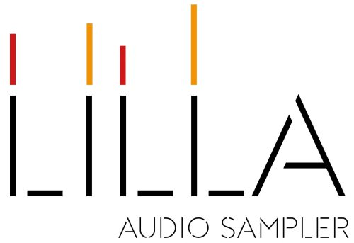
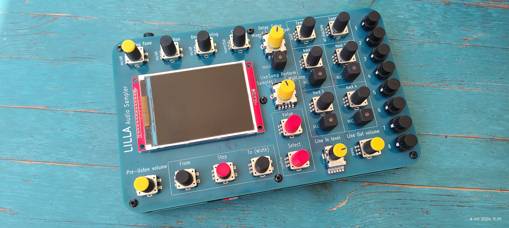

<p align="center">
	
</p>

# LILLA Audio Sampler 2026

This repository contains the firmware project for the LILLA Audio Sampler, a Teensy 4.1 based hardware sampler with up to 16 playback voices, designed and assembled in Italy.

The codebase targets a Teensy 4.1 running at 600 MHz and is organized as a standalone PlatformIO project with custom audio, display, storage, MIDI, and user-interface modules.

<p align="center">
    
</p>

Read the illustrated [User Guide](User%20Guide.md) for connections, controls and operating procedures. The printable English edition is [User Guide.pdf](User%20Guide.pdf).

See the [Firmware Architecture](FIRMWARE_ARCHITECTURE.md) for the audio engine, execution model, memory layout and maintenance guidance.

## New in firmware 7.2.9

**Switch antialiasing on or off with Value.** In Performance, select an Instrument's `TONE` field, choose a cutoff from 3.0 to 8.0 kHz, then press **Value** to toggle antialiasing for upward playback pitch from 1 to 2 (up to one octave). The `A` suffix shows that the option is enabled. Save the patch to retain the setting.

See the [7.2.9 release notes](docs/release-notes-7.2.9.md) and the illustrated [User Guide](User%20Guide.md#tone-consistent-timbre-when-transposing-upwards).

## SD folder layout

See [SD card formats and files](SD_FILES.md) for compatible filesystems, audio formats and each folder's purpose.

```text
microSD root/
  AUDIO_FILES/          Source audio and converted RAW files for SD playback
  UPLOAD_AUDIO_FILES/   Source audio for import into Flash
  EXPORTED_AUDIO_FILES/ Sampler WAV exports
  DATA_BACKUPS/         Numbered configuration and recording backups
  RESTORE_FROM_BACKUP/  Contents of the selected backup to restore
  LILLA_PRIVATE/        Firmware-managed metadata (Hidden/System)
    .lilla-index        SD audio catalog
    .lilla-sources/     Saved Sound source references
    MIDI_LOOPS/         Saved MIDI loops
    PATCHES/            Patch parameter copies
```

Keep playback audio in `/AUDIO_FILES` and its catalog and saved Sound references in `/LILLA_PRIVATE`. Place Flash import sources in `/UPLOAD_AUDIO_FILES`. To restore a backup, copy its contents directly into `/RESTORE_FROM_BACKUP`. See the [User Guide](User%20Guide.md#sd-folder-layout) for migration and backup instructions.

## SD audio library (introduced in 7.2.0)

Earlier firmware versions let you build patches from the samples you had imported into LILLA's 64 MB Flash memory. Firmware 7.2.0 opens up a much larger library: browse and audition your prepared audio collection on an SD card, choose the sounds or portions you want, and use them in your patches without having to import them into Flash.

You can still keep your favourite samples in the internal Flash library, within its 64 MB capacity, and choose from both libraries when creating patches.

See the [User Guide](User%20Guide.md#importing-audio) to get started, or read the [7.2.0 release notes](docs/release-notes-7.2.0.md) for details.

## What This Project Does

LILLA is a polyphonic, multitimbral, multi-MIDI audio sampler designed to work with imported audio, self-recorded audio, and live input.

| Mode | Features |
| --- | --- |
| Performance | Up to 16 playback voices and 200 patches, each with up to eight sounds, individual MIDI channels and keyboard ranges. |
| Sampler | Mono/stereo recording into Flash, conversion into playable sounds and WAV export to microSD. |
| Live Sampler | Circular PSRAM recording with approximately 40 seconds in mono or 20 seconds in stereo, adjustable feedback and capture of selected regions into patches. |
| MIDI Loop | Four tracks of MIDI events, played through the current patch and stored on microSD. |

Sound shaping includes sample trimming, forward/reverse and loop playback, envelopes, instrument filters and modulation, a common low-pass filter, stereo delay, bit reduction and downsampling. Separate main and pre-listening routes support auditioning and performance.

## Operating Modes

The **Modes** selector chooses Performance, Sampler, Live Sampler or MIDI Loop. Each mode offers a different way to use the same sound engine: play prepared patches, record a take, explore incoming audio or build a repeating MIDI arrangement.

### Performance

Performance is the main page for playing and organizing patches. Each patch contains up to eight sound slots with their own source, MIDI channel, root key, keyboard range, gain and pan. Assign overlapping ranges to build layers, separate ranges to create keyboard splits, or different MIDI channels to play several parts from a controller or sequencer. Up to 16 playback voices are shared between the active sounds, including layers and release tails.

The root key establishes the reference pitch of each sound. The keyboard range determines which notes trigger it, while precedence controls voice allocation and TONE provides pitch-dependent timbre correction. Patch volume, the common low-pass cutoff, resolution and downsampling are available for shaping the performance as a whole.

Press **S1-S8** to edit an active sound. Sound Edit provides source selection, waveform trimming, pitch, gain, pan, ADSR envelope and playback direction. One-shot modes suit hits and natural decays; forward, reverse and alternating loops extend a selected region into a sustained sound. Noclick provides boundary smoothing where supported. Auto Tune analyses the selected region and adjusts its pitch toward a chromatic note; the result can then be refined by ear.

The instrument VCF adds low-pass, high-pass, band-pass or notch filtering, resonance and modulation. Save the patch to retain sound edits, or clone it and develop a variation without replacing the original. See [Performance](User%20Guide.md#performance) and [Editing a sound](User%20Guide.md#editing-a-sound) for the complete workflow.

### Sampler

Sampler records the line input as a mono or stereo take in Flash. Use **PAUSE+REC** to monitor the source and set the input level, start the take with **MONO_REC** or **STEREO_REC**, then press **STOP** to finish. The resulting recording can be auditioned and used as material for a playable sound.

**MAKE_RAW** converts recording material into the source format used by patches. **EXPORT_WAV_TO_SD** writes a 16-bit, 44.1 kHz WAV to microSD for editing, sharing or archiving on a computer. This makes Sampler useful for recording an instrument, voice, percussion hit or complete phrase before deciding how to map it to the keyboard.

Recordings occupy persistent Flash storage, while WAV exports are written to `/EXPORTED_AUDIO_FILES`. Keep an external copy before replacing the audio library or performing destructive storage operations. See [Recording with Sampler](User%20Guide.md#recording-with-sampler).

### Live Sampler

Live Sampler records continuously into a circular PSRAM buffer: approximately **40 seconds in mono** or **20 seconds in stereo**. As recording proceeds, new material replaces the oldest audio. It is intended for playing and transforming an incoming source, finding useful moments in an ongoing recording, and turning those moments into new patch sounds.

The waveform view provides a window into the buffer. **From** sets the playback start, **To** adjusts the selected region, and **Step** changes the editing increment. The displayed window can be shortened to inspect a transient or expanded for a wider view of the recording. Playback modes let you audition a region once or repeat it as a loop.

Start-point behavior determines the relationship between playback and recording. **SYNC** starts playback close to the current write position; relative offsets move that start ahead of or behind it. **FIXED** anchors it to a location in the circular buffer. While recording, FWD playback continues across buffer wraps in both SYNC and FIXED, allowing held notes to continue beyond one buffer length. During the first fill, playback still stops with a fade if it reaches material that has not yet been recorded. After recording stops, normal one-shot FWD behavior resumes.

**Feedback** mixes the returning playback signal with the new input before recording, so earlier material can be recaptured and progressively transformed. Its level controls how strongly previous passes contribute to the next one.

A stereo-linked recording compressor controls the combined input and feedback level. Select **FEEDBACK COMPRESSOR**, then turn Value to choose a threshold from -24 to -3 dB or OFF.

To keep a region, stop recording, choose a loop mode, refine its boundaries and press **S1-S8** to select the destination slot. A MIDI key sets the captured sound's root key. Stereo captures can use adjacent slots for their left and right channels. Return to Performance to review the new patch and save it, which writes the captured audio to Flash. The live buffer itself is temporary and does not survive power-off. See [Live Sampler](User%20Guide.md#live-sampler).

### MIDI Loop

MIDI Loop records note events into **four tracks**, with up to **1,000 events per track** and a maximum original loop duration of **120 seconds**, and plays them through the current patch. It stores the performance as MIDI data, so changing the patch's sounds, filters or keyboard mapping can change the arrangement without recording the notes again.

Track 1 is the master and establishes the loop duration. Record the first phrase with **Rec 1**, close it by pressing Rec 1 again, then add parts using Rec 2, Rec 3 and Rec 4. Recording over an occupied track replaces its events; recording Track 1 again also clears the other tracks because it defines a new master loop.

Tracks can be started or stopped individually. Their **LEVEL**, **SHIFT** and **TRANSP** parameters adjust playback level, timing offset and note transposition. The Tempo control changes the timing of the MIDI sequence, while the Loop control selects saved loops and controls group playback. Tempo changes affect event timing rather than time-stretching sample audio.

Save an arrangement or save a new variation to microSD in `/LILLA_PRIVATE/MIDI_LOOPS`. Preserve its patch and audio sources alongside the loop files when archiving a complete session. See [MIDI Loop](User%20Guide.md#midi-loop).

## Audio Files and Storage

- Internal audio format: signed 16-bit PCM at 44.1 kHz.
- Import from microSD: mono RAW; mono/stereo WAV (PCM 8/16/24/32-bit or float 32/64-bit, 8-192 kHz); 16-bit PCM AIFF at 44.1 kHz; and MP3. WAV and MP3 are converted to mono 16-bit at 44.1 kHz. See [MP3 import](docs/mp3-import.md) for supported rates and implementation details.
- Flash imports preserve complete files, within Flash capacity. The playable region can move along the full file and is limited by the per-source PSRAM capacity.
- Flash stores imported audio and Sampler recordings; PSRAM provides live recording and playback caches; FRAM stores patch and configuration data.
- Configuration and recording backup/restore are available through microSD. A complete archive also requires separate copies of the imported audio library and MIDI-loop files; see [Backup and restore](User%20Guide.md#backup-and-restore).

## Hardware Summary

The firmware is written for a hardware platform built around:

- Teensy 4.1
- Teensy Audio Adaptor Rev D
- 64 MB SPI Flash memory (SPI)
- 32 MB total PSRAM (Quad-SPI)
- 128KB FRAM (I2C)
- ILI9341 display

## Connections and Buttons

| Connection | Specification |
| --- | --- |
| Line in | 3.5 mm jack; stereo line / stereo dynamic microphone input. |
| Line out | 3.5 mm jack; stereo line output, 3.1 Vpp. |
| Phones line | 3.5 mm jack; main stereo headphone output. |
| Phones pre-listen | 3.5 mm jack; stereo pre-listening headphone output. |
| MIDI IN / OUT | 3.5 mm jacks. |
| Gate IN / OUT | 3.5 mm jacks, +5 V. |
| USB-C | +5 V DC power and programming. |
| microSD | Audio import/export, backups and MIDI-loop storage. |

Dedicated buttons provide firmware upload mode and power on/off.

MIDI OUT and Gate IN/OUT are physically available and accessible through classes included in the codebase, but no user-facing features currently use them. They are available for future development.

## Repository Layout

- [src](src): application entry point and firmware sources
- [include](include): global headers and shared declarations
- [lib](lib): custom modules for audio, display, control, storage, and routing
- [doc/assets/images](doc/assets/images): images used by the README and User Guide
- [docs](docs): technical notes and implementation details
- [User Guide.md](User%20Guide.md): illustrated operating guide
- [FIRMWARE_ARCHITECTURE.md](FIRMWARE_ARCHITECTURE.md): technical architecture and maintenance guide
- [platformio.ini](platformio.ini): PlatformIO build configuration

## Firmware download

Firmware **7.2.9 (25 October 2026)**: download [Lilla_v7_2_9.hex](https://github.com/SandroGrassia/Lilla_Audio_Sampler/releases/download/v7.2.9/Lilla_v7_2_9.hex) from [release v7.2.9](https://github.com/SandroGrassia/Lilla_Audio_Sampler/releases/tag/v7.2.9). See the [7.2.9 release notes](docs/release-notes-7.2.9.md) for changes and the [User Guide](User%20Guide.md) for upload instructions.

## Build

Build the Teensy 4.1 firmware with PlatformIO:

```sh
pio run -e teensy41
```

The project targets Teensy 4.1 at 600 MHz. Building does not upload firmware to the instrument.

## Links

- [www.lillasampler.it](https://www.lillasampler.it/)
- [Facebook page](https://www.facebook.com/Lilla.audio.sampler)
- [Tindie product page](https://www.tindie.com/products/lillasampler/lilla-audio-sampler-2/)

## Acknowledgements

Special thanks to:

- **François Best**, for guidance on using the MIDI.h library within a class.
- **Giuliano Cardinali**, for valuable suggestions on hardware and software design and implementation.
- **Andreas Huelsmann**, for suggestions on MIDI Loop functionality and for beta testing it.
- **Stefano Spada**, for contributing to the development of advanced features and improving usability.
- **Thomas Spada**, for helping define the core features and improve usability.
- **Andrea Lombardini**, for the C++ lessons.


## License

This repository includes a [LICENSE](LICENSE) file. See it for the applicable terms.
